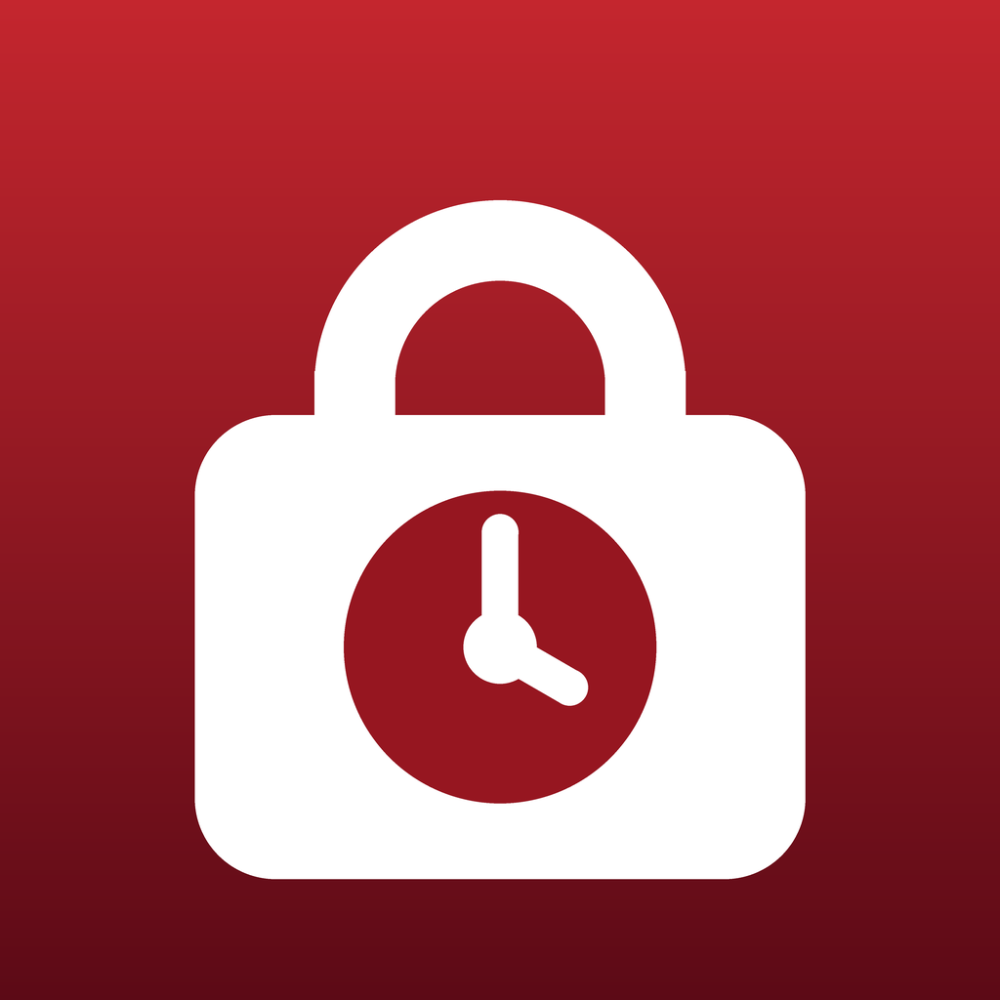

# Lockout

**A strict iPhone app blocker with no way out.** You pick a length (or a schedule starts it) and every app and website on the phone is blocked until the time is up. There is no stop button: not in the app, not by restarting the phone, not by deleting the app. Only time ends a lock. Phone and emergency calls always work.

Built because every other blocker has a "stop" button, and that is exactly the button you press at 11 PM.

- On-demand locks from 1 minute to 12 hours (extendable to 24 hours from the start), with a 10-second "last chance" countdown.
- Recurring and one-off schedules. Making a schedule **stricter** applies at once; making it **weaker** waits 24 hours, so you can't talk yourself out of tonight's lock.
- Optional Strict mode: Lockout generates a Screen Time passcode and keeps it sealed (shown 24 hours after you ask, never during a lock), so Screen Time itself can't be switched off on a whim.
- No account, no network, no analytics. Nothing leaves the phone, and the build fails if networking code ever appears.

## How it works

Apple's Screen Time APIs (`FamilyControls` with individual authorization, `ManagedSettings`, `DeviceActivity`) do the blocking. The app never "holds" a lock itself:

1. The app writes locks and schedules to a small file in an App Group shared with two extensions.
2. iOS launches the **DeviceActivityMonitor extension** whenever a lock or schedule starts or ends, even if the app is never opened again. Whatever the event, it re-reads the file, works out whether a lock should be running *right now*, and blocks or releases. Every lock and every release goes through that one function (`Enforcer.refresh`), so there is exactly one code path for each.
3. The **ShieldConfiguration extension** draws the "Locked until 7:00 PM" screen. There is deliberately no ShieldAction extension, so the block screen has nothing to tap.

### Designed to never brick the phone

A self-lock app has two failure modes: ending too early, and never ending. Lockout guards against both.

- **Never ends early.** A trusted clock (monotonic time since boot plus the boot session ID) means moving the phone's clock forward doesn't end a lock; Lockout also asks iOS to require automatic date and time during a lock.
- **Always ends.** Each lock has a backup release event 5 minutes after its end, a hard cap 25 hours after it started (whatever the saved data says), and damaged saved data reads as "no lock" (fails open).
- **No back doors in release builds.** A debug-only emergency release exists for testing; the build check fails any Release build that contains it.

### Loopholes, honestly

[`docs/LOOPHOLES.md`](docs/LOOPHOLES.md) lists every known way around a lock (changing the clock, revoking Screen Time access, Siri, notification replies, Always Allowed apps…) and marks each one closed, mitigated or open, with what was tested on a real iPhone. The short version: Lockout makes ending a lock early slow, deliberate and logged; iOS doesn't let any app make it impossible.

## Code tour

| Path | What |
|---|---|
| [`LockoutCore/`](LockoutCore) | All the rules as plain Swift with unit tests: lock lengths and caps, the 24-hour cooldown classification (stricter vs weaker schedules), clock-tamper handling, passcode reveal timing, DeviceActivity planning |
| [`Shared/`](Shared) | The saved-state file (coordinated, atomic, fail-open), the device clock, and `Enforcer`, the one place that turns state into Screen Time settings |
| [`App/`](App) | SwiftUI screens: 3-screen setup, lock presets, arming countdown, lock countdown, schedules, Strict mode, history |
| [`Monitor/`](Monitor) | `DeviceActivityMonitor` extension |
| [`Shield/`](Shield) | `ShieldConfiguration` extension |
| [`project.yml`](project.yml) | XcodeGen spec; the Xcode project is generated in CI and never committed |
| [`codemagic.yaml`](codemagic.yaml) | Cloud builds: tests + compile on every push, signed builds and TestFlight uploads on tags |
| [`scripts/check-ipa.sh`](scripts/check-ipa.sh) | Post-build checks: entitlements on all three targets, correct extension points, no networking symbols, no debug unlock in Release |

The whole app was built and shipped **without a Mac**: XcodeGen generates the project on Codemagic's macOS machines, signing files are created through the App Store Connect API, and development builds are installed over USB from Windows with [`pymobiledevice3`](https://github.com/doronz88/pymobiledevice3) (`npm run phone:install`).

## Building it yourself

You need an Apple Developer Program membership (Screen Time's Family Controls capability isn't available on free accounts) and either a Mac with Xcode or a Codemagic account.

1. Change `DEVELOPMENT_TEAM` and the `fun.thedailygame.lockout*` bundle IDs in `project.yml` to your own, and register the three IDs plus the App Group with the **Family Controls** and **App Groups** capabilities.
2. Mac: `brew install xcodegen && xcodegen generate`, open `Lockout.xcodeproj`, run on a real iPhone (Screen Time APIs don't work in the simulator).
3. Codemagic: see `codemagic.yaml`; `npm run ship` tags a development build, `npm run ship -- --testflight` a TestFlight build.

Unit tests run anywhere Swift does: `cd LockoutCore && swift test`.

## License

[MIT](LICENSE)
